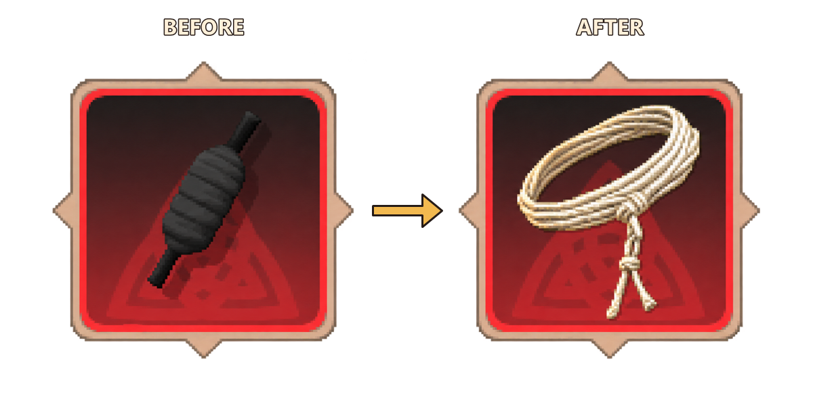

# Epic Loot Skuld's Thread Graphic

Gives Epic Loot's Skuld's Thread a cream-colored, knotted rope model and matching inventory and tracker icons. This cosmetic add-on preserves the existing item, stats, recipes, and tracker behavior.

## Requirements

- Valheim
- [Epic Loot 0.16.0](https://thunderstore.io/c/valheim/p/RandyKnapp/EpicLoot/)
- [Jötunn 2.30.3](https://thunderstore.io/c/valheim/p/ValheimModding/Jotunn/)
- [BepInExPack for Valheim 5.4.2360](https://thunderstore.io/c/valheim/p/denikson/BepInExPack_Valheim/)

The versions above match the tested setup. Epic Loot also pulls in JsonDotNET 13.0.4. Thunderstore mod managers install the dependencies automatically.

## Installation

Install with a Thunderstore mod manager or, with Valheim closed, extract the archive into your active profile or manually modded Valheim folder so the DLL lands under BepInEx/plugins. If you previously installed the private Skuld's Thread Rope build, remove that copy before installing. Both builds use the same plugin ID.

## Building

Run build.ps1 with -ManagedPath pointing to Valheim's valheim_Data/Managed folder, -BepInExPath pointing to the profile's BepInEx folder, and -CompilerPath pointing to csc.exe. The build writes bin/SkuldsThreadRope.dll.

OctoberJemini playtested the appearance in game. Artwork includes an AI-assisted package icon and a cleaned-up comparison based on in-game screenshots.
