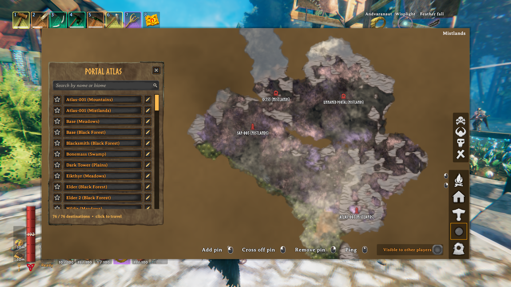
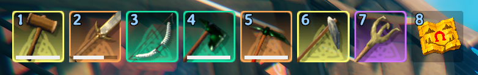
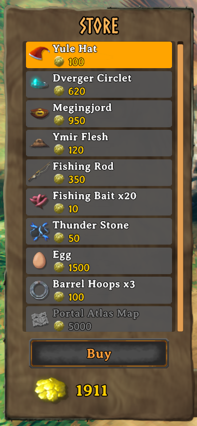
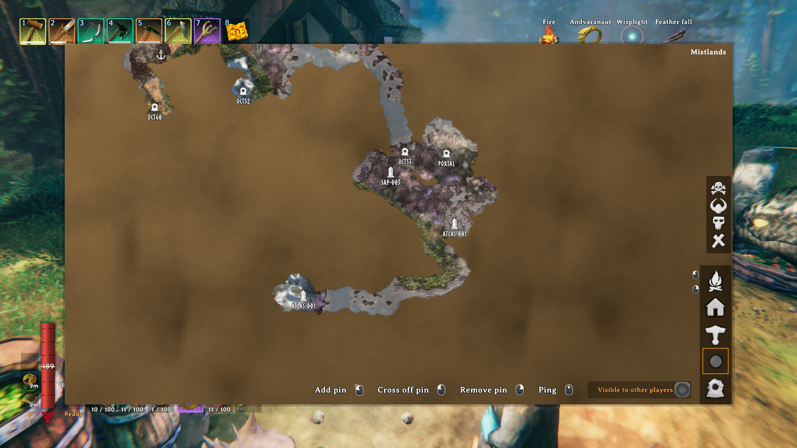

# Portal Atlas Map

**Carry your portal network with you.** Buy an enchanted map from Haldor, open it from your inventory or hotbar, and travel to any normal portal or Atlas pillar in the current world. Search destinations, star your favourites, and give places useful names.

[Report a bug](https://github.com/OctoberJemini/ValheimMods/issues/new?template=bug_report.yml) | [Request a feature](https://github.com/OctoberJemini/ValheimMods/issues/new?template=feature_request.yml) | [Source code](https://github.com/OctoberJemini/ValheimMods/tree/main/mods/Portal_Atlas)

## Screenshots

### Atlas travel picker

Search destinations, save favourites, rename locations, and click a destination name or red map marker to travel.

### Atlas on the hotbar

Keep the map in your inventory, or put it in a numbered hotbar slot for quick access.

### Buy the map from Haldor

Haldor sells the Portal Atlas Map for **5,000 coins**.

### Your ordinary map

The ordinary map retains its normal controls and shows passive pillar markers. Open the Atlas item to use the travel picker.

## Quick start

1. Install Portal Atlas Map and its BepInExPack Valheim and Jotunn dependencies, then restart Valheim. For multiplayer, install it on the server and every player's client.
2. Find **Haldor** and buy **Portal Atlas Map for 5,000 coins**. This is a one-time item purchase, not a travel fee.
3. Keep the map in your inventory. **Right-click the item**, or place it in a numbered hotbar slot and press that slot's key. You do not equip it or use a separate Atlas hotkey.
4. Wait a moment for the destination list to populate. Use the search box to find a portal or biome.
5. **Click a destination name or its red map marker to teleport immediately.** There is no extra confirmation or separate Travel button.
6. Click the **star** to favourite a destination or the **pencil** to rename it. Hover a list row to pulse its map marker.

You can also **walk into a normal portal** to open the destination picker without buying a map. Buying and carrying the Atlas adds remote access from anywhere and unlocks the buildable Atlas pillar.

## Controls

| Action | How to do it |
| --- | --- |
| Open Atlas travel from anywhere | Carry the Atlas, then right-click it in inventory or use its hotbar slot |
| Open Atlas travel without an Atlas | Walk into a normal portal |
| Travel | Click a destination's name in the list or its marker on the Atlas map |
| Search | Type part of a destination name or biome into the search box |
| Favourite / unfavourite | Click the star beside a destination; favourites appear first |
| Rename from the list | Click the pencil, enter a name, then press Enter or click Okay |
| Rename a physical pillar | Carry an Atlas, look at the pillar, and press your interact key (default E) |
| Rename a normal portal's Atlas label | Look at the portal and press your interact key (default E) |
| Scroll the list | Use the mouse wheel, drag the visible scrollbar thumb, or click its track |
| Close the Atlas panel | Click the X in its upper-right corner |
| Open the ordinary map | Use your normal map key (default M); it does not start Atlas travel |

Destination buttons travel immediately. Use the star and pencil buttons for their respective actions instead of clicking the destination name.

## Build your own Atlas pillars

Owning an Atlas unlocks the **Atlas pillar** in the hammer's **Misc** category for that character. You need:

- **20 Stone**
- **1 Wisp**
- **1 Surtling Core**

**No workbench is required.** Place it on a valid build surface and rotate it normally. Pillars use free-form placement without snapping to other structures. A pillar is a destination: it does not need another pillar, portal pairing, fuel, or a matching name to work.

The grey-stone waystone has orange glowing windows and base insets, knotwork carvings, and a small blue-white wisp above its crown. It is approximately shoulder height. The decorative wisp stays over the pillar and gently bobs; it does not follow you or clear Mistlands mist.

New pillars are named automatically, for example **Atlas-001 (Meadows)** and **Atlas-002 (Meadows)**. Each biome has its own sequence. The biome is added to the name in the destination list and map labels. Renaming a pillar updates the physical pillar's hover name as well. Submit an empty pillar name to restore its automatic name.

Dismantle or destroy the physical pillar to remove its destination and map marker. Map-delete controls cannot remove Atlas-managed pillar markers.

## How normal portals work

Normal portals become entrances to the Atlas destination picker. **Matching portal tags and paired portals are not required while Portal Atlas is enabled.** Walk into a portal, choose any listed destination, and travel there.

Renaming a normal portal through Atlas changes its **display label**, preserving its underlying vanilla tag. Existing portals stay in your world; no conversion or rebuilding is needed. If Portal Atlas is removed later, normal portals return to vanilla pairing behaviour using those underlying tags.

A carried Atlas lets you travel remotely. Without one, remain beside the normal portal that opened the picker; the server requires you to stay within six metres when approving the trip. Pillars are destinations and do not provide the normal portal's walk-in picker interaction.

## The Atlas map and your ordinary map

The Atlas uses the familiar map view with a destination list and highlighted red portal/pillar markers. It retains your existing map pins.

- **All normal portals and Atlas pillars in the current world can be listed, including destinations you have not discovered.** Showing destinations does not reveal unexplored terrain.
- Normal portals use the familiar portal icon. Pillars use their own obelisk symbol. Labels follow the game's native map-pin styling.
- Existing matching portal pin artwork is reused where available to avoid drawing duplicate markers.
- The ordinary map and minimap can show passive pillar markers once their surroundings are explored or you are nearby. These markers do not allow travel from the ordinary map.
- Red highlights and the travel list belong to the Atlas view. Closing that view restores the normal map presentation.
- Newly placed or removed destinations may take a few seconds to appear or disappear. The initial world scan can take longer.

## Favourites and renaming

Favourites are saved **per character and world**, immediately when you click the star. Names can be changed without losing a favourite. Location-based storage keeps stars associated with destinations across world reloads; physically moving a destination changes its identity.

**Upgrading from the earlier private test builds:** old ID-only favourite files are preserved, but you must star your destinations again once. Those old IDs were reassigned by Valheim during loading and cannot safely identify the original selections. Public 0.2.8 uses the corrected format.

## Travel restrictions

Portal Atlas respects the game's map and portal restrictions. It checks that you can travel, including death, sleeping, cutscenes, an existing teleport, portal-related world modifiers, applicable boss restrictions, and native item teleportability. It does not automatically make restricted items teleportable. A destination portal that natively permits all items retains that permission.

Travel uses the real destination object and arrives in front of it. Choose a sensible, unobstructed location when building a pillar. The server provides and validates the destination; typing map coordinates is not supported. Travel is limited to the current world.

## Installation and multiplayer

Use a Thunderstore-compatible mod manager to install **Portal Atlas Map** with **BepInExPack Valheim** and **Jotunn**. The package declares the dependencies automatically. Restart the game after installation or updates.

For manual installation, install those dependencies first, then put `PortalAtlas.dll` in `BepInEx/plugins/OctoberJemini-PortalAtlas/`.

For multiplayer, **the host/dedicated server and every player need Portal Atlas and its dependencies**. Use the same release on all participants. Dedicated-server and broader multiplayer compatibility have not yet been comprehensively verified; this first public release follows local in-game testing and automated checks.

## Optional companion: Auto Mapping

[Auto Mapping](https://thunderstore.io/c/valheim/p/OctoberJemini/Auto_Mapping/) is a companion mod that automatically marks placed or discovered portals and encountered dungeons and landmarks on your ordinary map. It keeps portal labels up to date, removes markers for destroyed portals, and crosses off visited locations. Portal Atlas Map handles travel, while Auto Mapping helps keep track of the places you build and discover. Auto Mapping is optional; Portal Atlas Map works on its own.

## Configuration, backups and removal

Start the game once to generate `BepInEx/config/OctoberJemini.PortalAtlas.cfg`. Under `[Trader]`, `AtlasPrice = 5000` controls Haldor's price. Quit the game before editing configuration; for multiplayer, keep the relevant configuration consistent across installations.

Back up your characters, worlds, and the mod's data folder before updates or moving hosts:

- **World names, portal aliases and number counters:** `BepInEx/config/OctoberJemini.PortalAtlas/world-<worldUID>.json` and its `.bak`. Copy this data when moving a world to another host. Pillars also retain name/sequence metadata in world objects when the owning peer is available.
- **Favourites:** `BepInEx/config/OctoberJemini.PortalAtlas/client-favourites/<characterID>-<worldUID>.v2.txt` and its `.bak`, with an additional character-data copy. Intentional unstarring remains saved.
- **Pillar construction unlock:** stored with the character.

Before uninstalling, dismantle Atlas pillars and remove Atlas map items, save, and close the game. Then remove the plugin. Keep the data folder if you intend to reinstall. Normal portals remain normal world objects.

## Troubleshooting

**The Atlas is missing from Haldor's shop:** check that Portal Atlas and Jotunn loaded without errors, restart after installation, and check your BepInEx log. Make sure you are visiting Haldor.

**The pillar is missing from the hammer menu:** obtain an Atlas first, then check the Misc category. Carry the Atlas when renaming a pillar.

**The list is empty or a new destination is missing:** give the initial catalogue scan a moment. Build a portal or pillar if none exist. On multiplayer, confirm the mod is installed on the server and all clients.

**A destination does not travel:** use the Atlas view, not the ordinary M map. Keep the Atlas in your inventory, or remain beside the source portal. Check for restricted inventory items, world modifiers, and an in-game message explaining the block.

**An old favourite disappeared:** private test builds need one-time re-starring for the corrected format. Update all installations to the latest release and check the favourites files before deleting anything.

## Support and credits

[Report a bug](https://github.com/OctoberJemini/ValheimMods/issues/new?template=bug_report.yml) or [request a feature](https://github.com/OctoberJemini/ValheimMods/issues/new?template=feature_request.yml). **We support the latest release of the mod and Valheim. Please update both before reporting a problem.** Include single-player/hosted/dedicated setup, reproduction steps, relevant other mods and a short BepInEx log excerpt. Remove credentials and personal information before posting logs.

Created for OctoberJemini with Codex. Code and original artwork were made with AI assistance. Runtime effects and shaders are referenced from the installed game; Valheim's game files are not included in this package.
